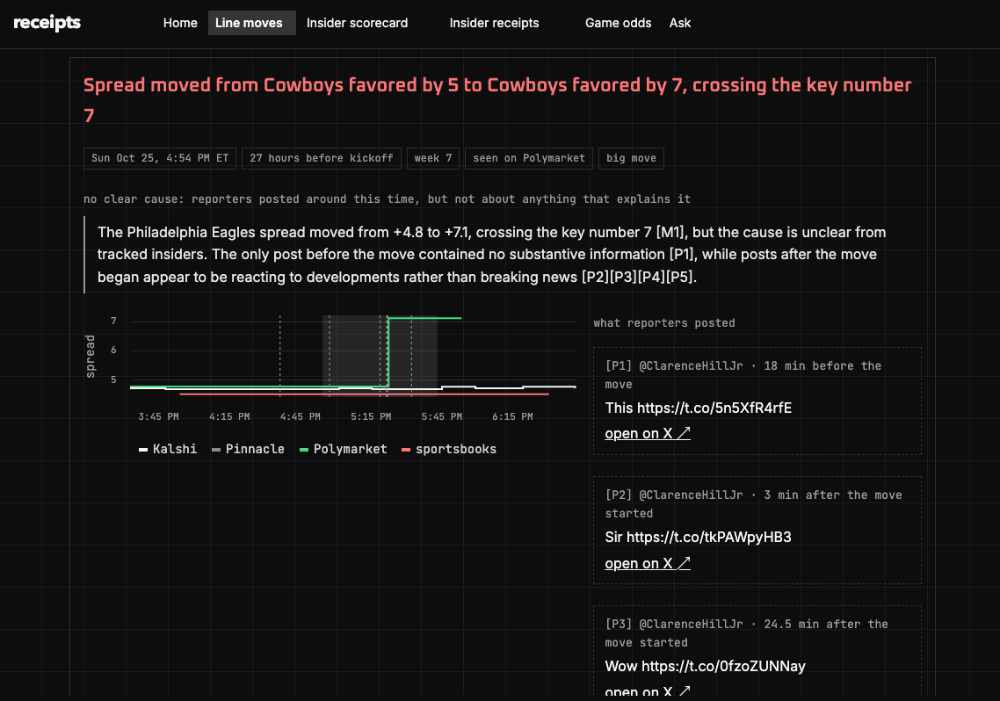

# receipts

**Why the line moved. Who called it first.**

receipts watches NFL betting markets around the clock. When a game's odds suddenly jump, it finds the NFL reporter post on X that most likely caused it and explains the move in plain English, citing only those posts. It also keeps score on the reporters: every checkable claim they make ("X is out Sunday", "Y will start") is checked against official stats after the game, so you can see who's actually right and who's first.



*The **Line moves** page: what moved, when, on which markets, a chart of each market around the move, and the reporter posts behind it. Here no post explained the move, so it says "no clear cause" instead of guessing.*

---

## What you can do with it

| Page | What it answers |
|---|---|
| **Line moves** | A game's odds just jumped: what changed, when, was it confirmed on more than one market, and what probably caused it? |
| **Insider scorecard** | Which reporters are actually right? Who's first? Whose posts move the market? Trust score 0–100, right calls, scoops and badges. |
| **Insider receipts** | Every claim one reporter made, whether it held up, and how it was checked (e.g. "won't play · ✅ right · didn't play a snap"). |
| **Game odds** | Our own win-probability model next to the market for every upcoming game, plus an honest report card on how the model does. |
| **Ask** | Plain-English questions like "Who broke the Lamar Jackson news first?", answered only from stored data, with sources. |

Every explanation and answer goes through a grounding check. Numbers must come from the data, every claimed cause must cite a post, and a post published *after* a move is never credited as its cause. If the evidence doesn't support an answer, it says so instead of guessing.

## How it works

```
 Kalshi · Polymarket · sportsbooks          X posts from ~70 NFL reporters         nflverse (official stats)
            │ every minute                          │ around each move + sweeps                 │ after games
            ▼                                       ▼                                            ▼
     odds snapshots ──► detect moves ──► link posts about that game ──► grounded explanation      │
                                                    │                                            │
                                                    └──► extract claims ──► check vs stats ◄─────┘
                                                                                 │
                                                                    reporter scores ──► trust score
```

1. **Watch the markets.** Win odds, spreads and totals for every game, every minute from Kalshi and Polymarket, and a few times a day from sportsbooks (The Odds API).
2. **Detect moves.** A team's win chance changes 3+ points within 30 minutes, the spread crosses 3, 7, 10 or 14, or the total moves 1.5+ points. A move seen on two markets at once is flagged as confirmed.
3. **Find the cause.** It searches what tracked reporters posted on X in the hour before the move (via Grok's `x_search`), keeps only posts about that game, and has an LLM explain the move from those posts alone.
4. **Keep the receipts.** Claims in those posts are extracted and checked against nflverse snap counts, play-by-play and rosters. Each reporter's accuracy, speed and market impact become a trust score, which feeds back into step 3.

## Quick start

You need Python 3.11+ (3.12 recommended), macOS or Linux, and git.

```bash
git clone https://github.com/shorjain/nfl-lines.git
cd nfl-lines
python3.12 -m venv .venv
.venv/bin/pip install -r requirements.txt
cp .env.example .env            # then fill in the keys you have (see below)
```

Load this season's games and rosters, then collect one round of odds:

```bash
.venv/bin/python -m pipelines.load_nflverse
.venv/bin/python -m pipelines.run_all
```

Keep it collecting in the background (macOS; on Linux, run `python -m pipelines.ingest_odds --loop` under your process manager):

```bash
.venv/bin/python -m scripts.service install
```

Open the app:

```bash
.venv/bin/streamlit run app/Home.py
```

Then go to **http://localhost:8501**. Data builds up as the collector runs. The season backfill fills in past games within about an hour, and reporter scores fill in as games are played and stats arrive, usually a day or two later.

## Keys and costs

Only the free sources are needed to start; everything else is optional.

| Source | What for | Needed? | Cost |
|---|---|---|---|
| Kalshi, Polymarket | live and historical market odds | built in | free (public APIs) |
| nflverse | schedules, rosters, snap counts, play-by-play | built in | free |
| [The Odds API](https://the-odds-api.com/) | sportsbook lines, Pinnacle | optional | free tier (500 credits/month); the default schedule stays inside it |
| [xAI](https://console.x.ai/) (Grok `x_search`) | reading reporter posts on X | optional, but needed to find causes | pay per call; capped by `XAI_DAILY_BUDGET_USD` with a Mac alert at `XAI_NOTIFY_USD` |
| [Snowflake](https://signup.snowflake.com/) | cloud copy, embeddings and the LLM (Cortex) | optional | free 120-day trial; or run fully local (below) |

Set `XAI_ENABLED=false` to turn off all X searches. Every setting is documented in [`.env.example`](.env.example) and in the [technical reference](docs/TECHNICAL.md#environment-variables).

### Running fully local (no Snowflake)

Swap the cloud AI for local models: embeddings from sentence-transformers, and an LLM from [Ollama](https://ollama.com/).

```bash
brew install ollama
```
```bash
ollama serve
```
```bash
ollama pull qwen2.5:3b
```

Then set `AI_BACKEND=local` in `.env` (and leave `SNOWFLAKE_ACCOUNT` empty) and restart the collector. Larger models like `qwen2.5:7b` explain better.

## Everyday commands

| Command | What it does |
|---|---|
| `python -m scripts.service status` | is the background collector running? recent log lines |
| `python -m scripts.service logs` | follow the collector's log |
| `python -m scripts.service uninstall` | stop and remove the background collector |
| `streamlit run app/Home.py` | open the app at http://localhost:8501 |
| `uvicorn api.main:app` | JSON API: `/moves`, `/moves/{id}`, `/ask?q=` |
| `python -m pipelines.backfill --status` | season backfill progress (with the collector stopped) |
| `python -m scripts.verify_handles` | check the reporter handles in `config/insiders.yaml` |
| `pytest -q` | run the tests (no network needed) |

Run commands from the repo root with the virtualenv's Python (`.venv/bin/python`). Only one process can write the local database, so stop the collector before running a pipeline that writes by hand.

## What's in this repo

```
nfl-lines/
├── app/          The web app (Streamlit)
├── api/          Read-only JSON API (FastAPI)
├── pipelines/    The jobs that collect, detect, explain, score and predict
├── sources/      Clients for each data source
├── store/        The only place that talks to the database
├── rag/          The "Ask" chatbot and the grounding check
├── common/       Shared helpers
├── config/       Data you can edit without touching code
├── scripts/      Setup, probes and maintenance tools
├── tests/        Unit tests with recorded API responses
├── docs/         Technical reference and images
├── trading/      Placeholder for the optional trading module (not built)
├── .streamlit/   App theme
├── .env.example  Every setting, with defaults (copy to .env)
└── requirements.txt
```

| Folder | What's inside |
|---|---|
| **`app/`** | `Home.py` starts the app and sets up the menu and theme. `views/` holds one file per page (home, moves, scorecard, insider, games, ask). `ui.py` has the look and plain-language helpers; `data.py` loads data for the pages. |
| **`api/`** | `main.py`: the same data as JSON, plus the Ask endpoint. |
| **`pipelines/`** | The jobs. `ingest_odds.py` is the main loop that runs everything on a schedule. Then `detect_moves.py` (find moves), `compare_venues.py` (Kalshi vs Polymarket, who moved first), `search_moves.py` / `sweep_insiders.py` / `search_x.py` (X searches with a daily budget), `explain_moves.py` (grounded explanations), `extract_claims.py` → `resolve_claims.py` → `score_insiders.py` (the scorecard), `train_model.py` (win-probability model), `backfill.py` (season history, resumable), `sync_snowflake.py` (hourly cloud copy), and `load_nflverse.py` / `run_all.py`. |
| **`sources/`** | `kalshi.py`, `polymarket.py`, `odds_api.py`, `nflverse.py`, `xsearch.py` (X posts, kept only when X confirms them), and `ladder.py` (turns a ladder of yes/no markets into one spread or total). |
| **`store/`** | `schema.py` defines every table once. `base.py` has the shared queries; `duckdb.py` (local, default) and `snowflake.py` (cloud) implement them. No SQL lives anywhere else; a test enforces it. |
| **`rag/`** | `parse.py` reads a question (teams, players, reporters, time window), `retrieve.py` gathers evidence, `answer.py` writes the answer, and `guard.py` is the grounding check shared with move explanations. |
| **`common/`** | Settings, team names and codes, which reporters to search, whether a post is about a given game (`relevance.py`), local AI models, logging, Mac notifications, and Parquet copies of raw data. |
| **`config/`** | `insiders.yaml`: the ~70 tracked reporters (handle, outlet, teams, verified). `thresholds.yaml`: what counts as a move, sweep and Odds API schedules, comparison settings. Edit these freely. |
| **`scripts/`** | `service.py` (install the background collector), `verify_handles.py` (check and correct reporter handles), `relink_moves.py` (re-check which posts belong to which move), `probe_*.py` (call each API once and save a test fixture). |
| **`tests/`** | ~190 tests that run offline against `fixtures/`, real API responses recorded once. |
| **`docs/`** | [`TECHNICAL.md`](docs/TECHNICAL.md): the data model, every formula, costs, API quirks found along the way, and all settings. |

Local-only folders (git-ignored): `data/` holds the databases, raw Parquet copies of every pull, model reports and logs. Your `.env` holds your keys.

## Learn more

The [technical reference](docs/TECHNICAL.md) covers:
- how moves are detected and scored, and the Kalshi vs Polymarket comparison;
- how posts are verified and matched to games;
- how claims are checked, and the exact trust-score formula;
- the win-probability model and its results, including that it doesn't beat the closing line yet;
- running after the Snowflake trial ends;
- every environment variable.
